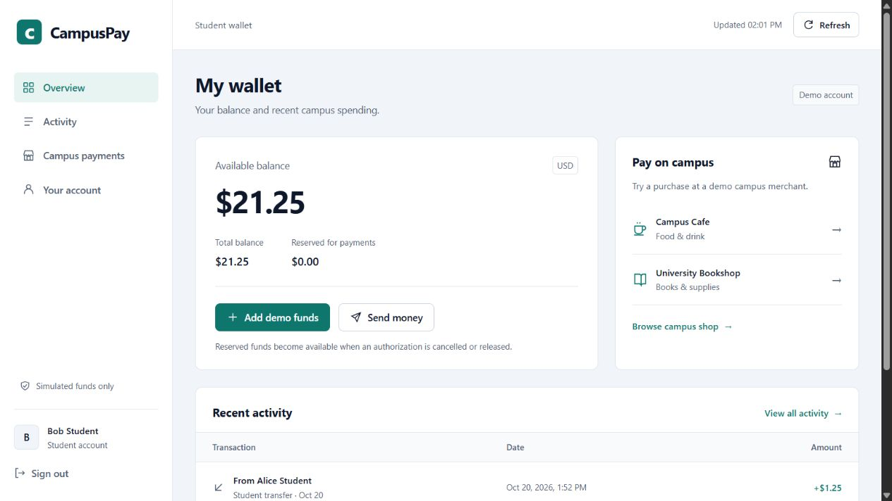
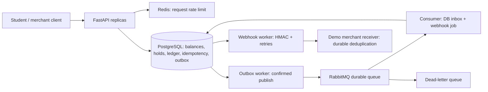

# CampusPay

A university digital wallet with a payment backend: fund a student wallet with simulated money, scan a merchant payment intent, reserve funds, capture, refund, transfer, and settle merchant proceeds. **No real funds, bank connections, card data, cryptocurrency, or blockchain transactions are processed.** This is an independent learning project, with no affiliation with Binance or any university.

Built with **Python 3.12+, FastAPI, psycopg 3, PostgreSQL 16, Redis 7, RabbitMQ 4, Docker Compose, and uv**. The focus is a correct vertical slice that can be demonstrated and tested, including database invariants and recovery from asynchronous failures.

## Run in Docker

Install Docker Desktop with Linux containers (or Docker Engine + Compose), and [uv](https://docs.astral.sh/uv/getting-started/installation/). From the project root:

```sh
uv sync --locked
docker compose up -d --build --wait
uv run --locked python scripts/demo.py
```

The first run downloads images and dependencies. No account registration or external service keys are required. Seed identities have **zero initial balances**; the demo explicitly funds Alice. Each demo invocation creates new keys and adds another simulated $100. Open the **[student dashboard](http://127.0.0.1:8080/)** and sign in as Alice or Bob with `campuspay-demo-only`. The [Swagger UI](http://127.0.0.1:8080/docs) remains available for merchant and operations workflows; select **Authorize** and use one of these accounts:

| User | Role | Password |
|---|---|---|
| `alice`, `bob` | Student | `campuspay-demo-only` |
| `cafe`, `books` | Merchant | `campuspay-demo-only` |
| `admin` | Operations / reconciliation | `campuspay-demo-only` |

You may copy `.env.example` to `.env` and change demo secrets before starting. All host ports bind to IPv4 loopback. The default credentials are public demonstration credentials, not a production identity system. Swagger's Basic credentials are shared within that browser, so switch the authorized user when changing roles. The student dashboard sends explicit credentials held only in tab memory and omits browser credentials.

## Student dashboard



The dashboard is served by FastAPI at `/` (also `/student`), with local HTML/CSS/JavaScript assets and no frontend build step or external CDN. Python and uv remain the application toolchain. It includes:

* Available, total and reserved balances; add simulated funds and review/confirm transfers to another seeded student.
* A fixed-price demo campus shop. Review a product and confirm payment; the server-controlled demo merchant captures immediately, using the same PostgreSQL ledger, outbox, and actor-scoped idempotency boundary. These are simulated purchases, not actual goods or orders.
* Payment-code entry for existing merchant QR intents. Review and authorize the amount; the merchant captures separately through the API. Uncaptured holds can be cancelled from Overview.
* Searchable/filterable activity with a newest-first cursor and an explicit button to load older results. Search applies to loaded transactions only.
* Student account information, sign-out, accessible native dialogs, error states and a responsive layout.

If a mutation returns an ambiguous network/server error, the dashboard retains its original request key and payload in **sessionStorage**, scoped to the student, and offers **Check payment**. New mutations are paused until that request is resolved. Reloading requires sign-in again and then recovers the pending request. Passwords and authentication headers are never stored in localStorage/sessionStorage. Closing the tab, clearing site data, or blocked storage can lose request recovery metadata; inspect activity before initiating a replacement for an uncertain payment. Successful payments stay successful even if the following balance refresh fails.

See [the dashboard guide](docs/DASHBOARD.md) for flows and verification notes. Camera-based QR scanning and a merchant dashboard are not included; paste a QR payload or request UUID instead.

Stop with `docker compose --profile test down`. Named volumes preserve demo balances, broker state, and receiver deduplication records. **`docker compose --profile test down -v` permanently deletes this project's simulated data** if you deliberately want a fresh demo.

## Run Python locally with uv

```sh
uv sync --locked
docker compose up -d --wait db redis rabbit
uv run --locked python -m campuspay.main
```

In two additional terminals, run `uv run --locked python -m campuspay.workers` and `uv run --locked python -m campuspay.receiver`. Then run the demo script in another terminal. API startup and worker startup apply checksummed SQL migrations under a PostgreSQL advisory lock. Host-run services default to `127.0.0.1`; Compose supplies internal service DNS names. Do not run host and container workers/receivers on the same ports simultaneously.

## Test

```sh
uv sync --locked
docker compose --profile test up -d --wait test-db test-redis test-rabbit
uv run --locked ruff check .
uv run --locked ruff format --check .
uv run --locked pytest --cov=campuspay --cov-report=term-missing
```

Optional JavaScript utility checks (Node.js 22+; **not required to run the dashboard**): `node --test tests/browser-utils.test.mjs`. These cover exact cent parsing, payment-code validation, actor-scoped retry recovery and transaction labels. CI runs them alongside the Python suite.

For unit tests without infrastructure: `uv run --locked pytest -m 'not integration'`. Integration tests use **real PostgreSQL, Redis, RabbitMQ, and a local HTTP server**, with injected failures only where explicitly named. The database must be named `campuspay_test`; tests create and remove a unique schema, use isolated Redis DB 15, and use a dedicated RabbitMQ container. Do not run multiple copies of the RabbitMQ suite against the same broker concurrently. Test connection overrides use `CAMPUSPAY_TEST_DATABASE_URL`, `CAMPUSPAY_TEST_REDIS_URL`, and `CAMPUSPAY_TEST_RABBIT_URL`.

See [the actual verification report](docs/TEST_REPORT.md) for the commands and results executed during delivery. Included GitHub Actions runs these checks and a Compose demo; a checked-in workflow does not imply a hosted CI run has occurred.

## Architecture



The API and worker are separate processes and can run on different hosts against shared infrastructure. This is a **single transactional ledger boundary with distributed asynchronous processing**, not a sharded ledger or a collection of independent balance microservices. Keeping the money transaction inside one database avoids a distributed transaction over two wallets. Multiple API/worker replicas coordinate with row locks and `SKIP LOCKED`; this repository tests concurrency through separate connections and service instances, not a multi-host load test.

### Correctness contract

* All amounts are strict integer **USD cents**: `100` means $1.00. Only USD is implemented. The operation limit is 1–1,000,000 cents. Floats, strings, booleans, unknown request fields, and unsupported currencies are rejected.
* Account rows lock in sorted ID order. Available funds equal `balance - reserved`. The check and debit/reservation happen in one transaction; an application-level or Redis lock is not trusted for spend correctness.
* `Idempotency-Key` is required for payment mutations, scoped to the authenticated actor, and retained without automatic expiry in this demo. The fingerprint includes the operation, target intent/recipient, and normalized validated payload. Replaying the same operation returns its original successful JSON; changing the payload or operation returns `409 IDEMPOTENCY_PAYLOAD_MISMATCH`. Concurrent first requests serialize through the unique database key. **Business failures roll back the key**, so a previously insufficient request can succeed after funding. This is documented behavior, not failure-response caching.
* Each money movement writes a balanced double-entry journal, updates balance projections, inserts its outbox event, and records its idempotent response in one commit. Deferred database triggers reject unbalanced or empty journals, mismatched account projections, and inconsistent authorization holds. Journal/entry updates and deletes are rejected, and new lines cannot be appended to an already committed journal. Database owners can bypass triggers; use proper runtime/migration roles before any real deployment.
* Authorization creates a hold for 15 minutes with no ledger movement. Capture is full and final; partial capture is deliberately excluded. Voiding or the expiry worker releases the hold. An expired authorization cannot be captured even if the expiry worker is stopped; its funds remain unavailable until released. Capture and void lock the intent first, so only one wins.
* Refunds support multiple partial amounts up to the captured total and require available merchant funds. **Settlement can make a later refund temporarily impossible**; this demo has no credit facility, reserve, chargeback, or refund guarantee. Settlement is a journal transfer to a simulated settlement clearing account, not a bank payout or bank reconciliation.
* Outbox publishing uses durable messages, mandatory routing, publisher confirms, persisted attempts, and exponential backoff. Confirmation followed by process death can publish the same event again. The consumer inserts an inbox row and webhook job in one database transaction, then acknowledges the message. Redelivery cannot create a second job. Exactly-once message delivery is not claimed.
* Consumer failures retry three times, then reject to a durable broker DLQ. Outbox and webhook jobs become `DEAD` after five attempts and require explicit operator replay. Backoff is 2, 4, 8, 16, 32 seconds (capped at 60 for future attempts). Replay resets the attempt budget.
* Webhooks include a stable event ID, timestamp, and HMAC-SHA256 signature over `timestamp + '.' + raw_body`. Delivery is at least once. The included receiver checks a five-minute timestamp window and durably deduplicates the ID and body digest. Only a fixed operator-configured destination is used; redirects are disabled. Requests time out and response bodies are streamed/discarded. This demo sends events for both merchants to one shared receiver; it is not a tenant-managed webhook platform.

### Ledger example

Wallets and settlement clearing have a normal credit balance; funding clearing is a normal debit asset. All journals sum debits and credits, rather than treating both sides as wallet balance increments.

| Operation | Debit | Credit |
|---|---|---|
| Simulated funding | Funding clearing asset | Student wallet liability |
| Transfer | Sender wallet liability | Recipient wallet liability |
| Capture | Student wallet liability | Merchant wallet liability |
| Refund | Merchant wallet liability | Student wallet liability |
| Settlement | Merchant wallet liability | Simulated settlement clearing liability |

`GET /api/admin/reconciliation` independently compares every projected balance and hold with the underlying journal entries and authorized intents. It is read-only. Deferred projection checks scan ledger history; this trades throughput for inspectable database invariants and is intentionally not advertised as a high-volume design.

## Operations and API

See [API examples and errors](docs/API.md), [failure recovery](docs/OPERATIONS.md), and [design tradeoffs and internship discussion points](docs/DESIGN.md). OpenAPI is generated at `/openapi.json`; a portable snapshot is in [docs/openapi.json](docs/openapi.json).

| Endpoint | Purpose |
|---|---|
| `GET :8080/health/live`, `/health/ready` | Liveness; readiness checks PostgreSQL and Redis |
| `GET :8080/metrics` | API Prometheus metrics, admin authentication |
| `GET :9100/metrics` | Worker Prometheus metrics, local development port |
| `GET :8080/api/admin/operations` | Outbox/webhook counts and bounded lists of dead jobs |
| `:15673` | RabbitMQ management; `campuspay` / `campuspay-local-only` |

JSON logs include request IDs, bounded route templates, worker event IDs, attempt counts, and outcomes; credentials and request bodies are not logged. HTTP metrics use route templates to avoid unbounded labels. Worker metrics run in the worker process, not the API registry. Queue depth and dead letters are visible through RabbitMQ management. Prometheus/Grafana servers are not bundled.

## Scope and security limits

HTTP Basic with a constant-time demo password check is intentionally simple. Roles and wallet ownership are enforced server-side. Same-origin browser writes are accepted for the dashboard; cross-origin and opaque (`null`) origin writes remain blocked to reduce cached-Basic-credential CSRF risk. CORS is not enabled. Dashboard HTML has a self-only Content Security Policy and no third-party scripts. Redis enforces atomic per-minute authenticated-IP and account limits and fails closed if unavailable. The API exposes no real payment network and the merchant URL cannot be supplied in API requests. Redis loss affects availability, not ledger correctness. RabbitMQ loss does not prevent API commits: events wait in PostgreSQL.

This local demo is **not production payment software**. Public deployment needs TLS, real individual authentication/authorization and credential rotation, runtime database/broker least privilege, trusted ingress/body limits, abuse controls, audit access policy, migrations as a separate deployment step, encrypted secrets/backups, disaster recovery, reconciliation against an actual funding provider, and operational monitoring. Images use version tags, not immutable digests; the Python dependency set is locked with hashes in `uv.lock`. The single-node RabbitMQ and PostgreSQL setup has no HA. No KYC/AML, card network, PCI compliance, fraud engine, FX, tokenization, or exchange integration is implied.

## Repository layout

```text
campuspay/       FastAPI, payment service, DB migrations, broker, workers, receiver
campuspay/web/   Student dashboard HTML, CSS, JavaScript and local SVG assets
tests/          Unit, PostgreSQL concurrency/invariant, API, delivery/failure tests
scripts/        Repeatable end-to-end demo (DLQ replay: python -m campuspay.replay_dlq)
docs/           API, architecture decisions, runbook, OpenAPI, actual test evidence
compose.yaml    Demo stack + isolated test profile
uv.lock         Reproducible dependency lockfile
```

Licensed under MIT. Before publishing to GitHub, keep `.env` and `.venv` excluded, choose your repository name (suggested: `campuspay`), and add your own author/project context. No GitHub repository is created or uploaded by the local build.
