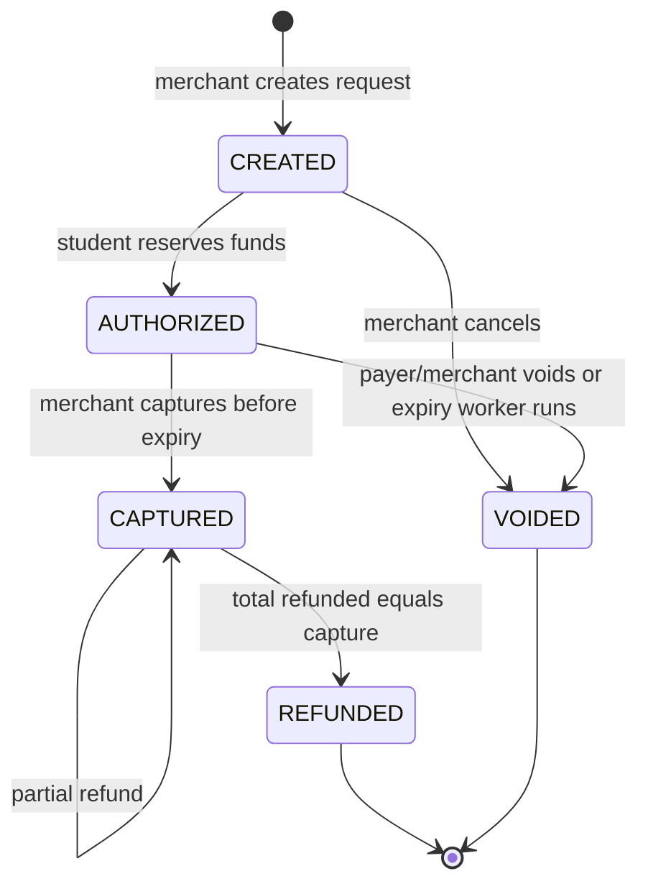

# Design and interview discussion

## Why this project fits payment backend conversations

A campus cafe purchase is a concrete way to explain payment-intent creation, student authorization, merchant capture, refund, and settlement. Student-to-student transfers exercise the same accounting boundary without merchant orchestration. The engineering topics overlap with backend payment platforms: concurrent balance updates, request retry semantics, durable asynchronous publication, webhook authenticity, duplicate delivery, reconciliation, observability, and recovery.

This repository is built in Python at the author's request. It does not demonstrate Java/Spring expertise, connect to Binance Pay, implement a card network, or reproduce Binance internals. Discuss it as a payment reliability demo, and avoid claiming real transaction volume, production use, or regulatory compliance.

## Decisions

| Decision | Benefit | Cost / next step |
|---|---|---|
| One PostgreSQL ledger boundary | Both sides, balance projections, holds, idempotency and outbox commit together | Single database is a throughput/failure boundary; no horizontal ledger sharding |
| psycopg SQL instead of ORM | Row-lock and deferred-constraint behavior is explicit and inspectable | More SQL; migrations and queries must be reviewed carefully |
| Sorted account locks + intent-first locking | Concurrent spends/refunds serialize; opposite transfers share lock order | Contention on hot accounts; bounded lock timeouts and client retries are required |
| Append-only journals + checked projections | Historical movements remain inspectable; database enforces balancing | Deferred reconciliation triggers scan history; replace with carefully designed incremental invariants for scale |
| Authorization as a separate hold | Balance and available funds express the capture lifecycle | Expiry needs a worker; partial capture/re-authorization excluded |
| Actor-scoped durable idempotency | Safe API retries across replicas and restarts, with payload mismatch detection | No retention cleanup; failures are not cached; account lock timeout may require caller retry |
| Transactional outbox, broker confirms, DB inbox | Handles commit/publish and process/ack crash windows without XA | At-least-once delivery; inbox/outbox grow and need a future retention policy |
| SKIP LOCKED while doing bounded external I/O | Small, understandable worker claims without a lease protocol | Holds database connections during network waits; production would use leases and recovery fencing |
| Separate API and worker processes | Queue outages do not require synchronous payment failure | One slow delivery can delay this demo worker's other loop tasks; split worker roles for higher throughput |
| Redis only for rate limiting | Fast atomic counters independent of payment data | Redis outage reduces availability; Redis persistence is not necessary for spend correctness |
| Fixed webhook destination | Avoids user-controlled internal-network destinations and redirects | Shared demo receiver; tenant onboarding and endpoint verification omitted |
| Single-node infrastructure | Small local setup and deterministic tests | No quorum-replication durability, failover proof, or disaster recovery claim |

## State machine

Every intent-changing command locks that intent before locking affected accounts. A transfer or funding command only locks accounts. External calls never occur in the money transaction. The outbox worker does perform broker I/O in its separate outbox-claim transaction; the webhook worker similarly performs bounded HTTP I/O while holding a delivery-job lock.

## Failure windows to explain

1. **Before payment commit:** transaction rollback removes balance changes, journal, outbox row and idempotency key. A retry can execute normally.
2. **After commit, before HTTP response:** retry the same key; the original response is returned without another posting.
3. **Before publish:** outbox remains PENDING. Broker outage cannot erase the committed intent to publish.
4. **After publish confirmation, before SENT commit:** publish occurs again. Event ID remains stable.
5. **After inbox/job commit, before broker ack:** redelivery sees the inbox key and creates no second delivery job.
6. **After merchant processes webhook, before worker records delivery:** send again; merchant deduplicates. HTTP delivery itself is not exactly once.

The suite injects a process-death exception at window 4, closes an actual broker channel without ack at window 5, and exercises actual HTTP 500/302 responses and signature verification. It also injects SQL and connection failures, with the exact scope recorded in the test report. These are targeted correctness tests, not proof of all failure modes.

## Possible truthful resume bullet

> Built CampusPay, a Python payment-processing demo with PostgreSQL double-entry accounting, database-locked wallet spending, idempotent APIs, and RabbitMQ outbox/inbox delivery; tested concurrent spends, crash recovery, refunds, and signed webhook retries using real local infrastructure.

Add a measured result only when you can reproduce it. A thread-based concurrency test is not a benchmark, and statement coverage is not a guarantee of financial correctness.

## References

The implementation follows the distinctions in [RabbitMQ's reliability guide](https://www.rabbitmq.com/docs/reliability) and [publisher-confirm/consumer-ack documentation](https://www.rabbitmq.com/docs/confirms). Transaction boundaries use [psycopg's documented commit/rollback context behavior](https://www.psycopg.org/psycopg3/docs/basic/transactions.html). See [PostgreSQL explicit locks](https://www.postgresql.org/docs/16/explicit-locking.html), [FastAPI's demo HTTP Basic guidance](https://fastapi.tiangolo.com/advanced/security/http-basic-auth/), and [uv's locking/sync documentation](https://docs.astral.sh/uv/concepts/projects/sync/).
